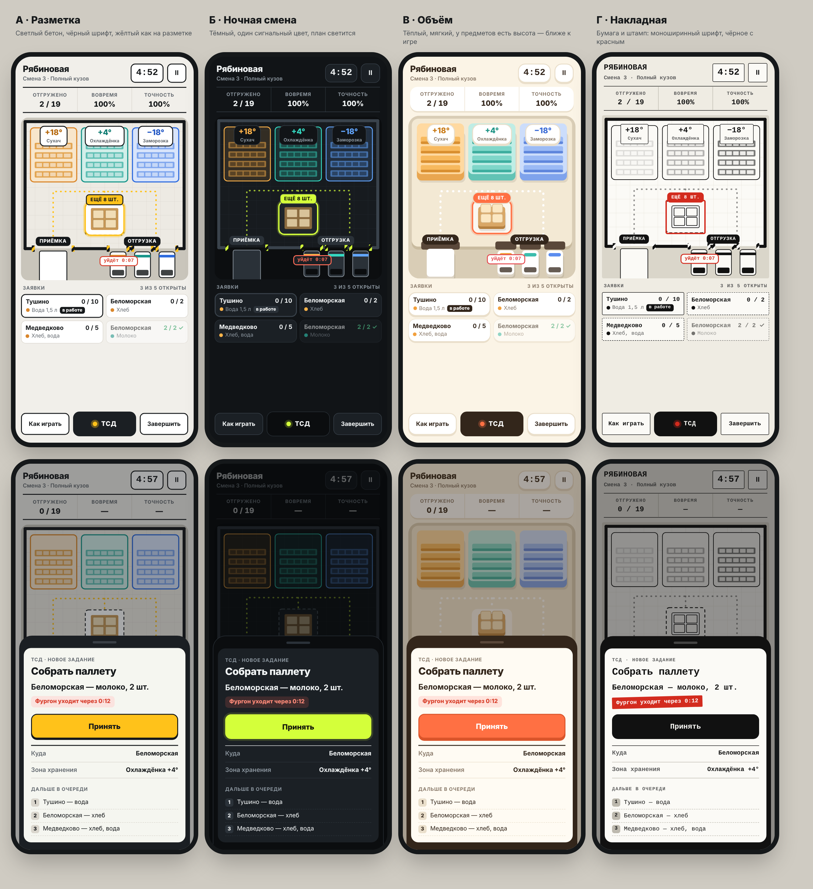

# Редизайн: варианты и подложка

Игра выглядит как собранная на коленке: тёмно-зелёные градиенты, свечения,
эмодзи, фотография склада с кучей лишнего. Решено переделать вид целиком.
Направление ещё **не выбрано** — ниже четыре варианта на одних и тех же двух
экранах (смена и задание на ТСД).



| | Вариант | Суть |
|---|---|---|
| А | Разметка | Светлый бетон, чёрный шрифт, жёлтый как на разметке. Плоско, без градиентов. |
| Б | Ночная смена | Тёмный, один сигнальный цвет (лайм), план склада светится. |
| В | Объём | Тёплый, мягкий, у предметов есть высота и тень — ближе к игре. |
| Г | Накладная | Бумага и штамп: моноширинный шрифт, чёрное с красным. |

Собрать картинку заново: `python3 build_variants.py` рядом с `variants.css`
создаёт `variants.html`.

## Что общего у всех вариантов

Это требования, а не вкус — они пришли из игры:

- **Склад — схема сверху, без лишнего.** Три зоны наверху, место сборки паллеты
  в центре, внизу стена с воротами.
- **Приёмка и отгрузка — ворота.** Слева одни широкие ворота с фурой, справа
  три узких с фургонами. Раньше приёмка была «вообще непонятно что».
- **Показатели и часы — в шапке**, а не поверх картинки.
- **ТСД — отдельный предмет**: тёмный прибор, одна кнопка действия.
- Зона товара на приёмке нигде не подсказывается (см. `docs/HANDOFF.md`).

## Подложка

`scene-placeholder.svg` — временная схема, нарисованная руками. Под неё стоят
кнопки, поэтому в сгенерированной картинке расположение должно совпасть:
зоны сверху (сухач, охлаждёнка, заморозка слева направо), паллета в центре,
приёмка слева внизу, отгрузка справа внизу. Пропорции — 780×760.

Промт для генерации:

```
Top-down orthographic view of a small warehouse interior, square 1:1 composition,
clean flat illustration, minimal detail, soft even lighting, no text, no people, no logos.
Light concrete floor with faint tile grid and yellow dashed lane markings.
Top third: three storage zones side by side as rounded blocks with shelving rows —
left zone warm amber/orange, middle zone teal, right zone blue.
Center: an empty marked square on the floor with one wooden pallet carrying four cardboard boxes.
Bottom: a thick dark wall running across, with four dock doors framed by yellow-black hazard stripes —
one wide door on the left, three narrow doors on the right.
Below the wall, outside on grey asphalt: one white semi-trailer backed into the left door,
and three small white delivery vans backed into the right doors, their roofs marked orange, teal and blue.
Muted palette: warm grey, off-white, charcoal, safety yellow accents. Plenty of empty floor space.
```

Палитру в последней строке промта надо заменить под выбранный вариант.
